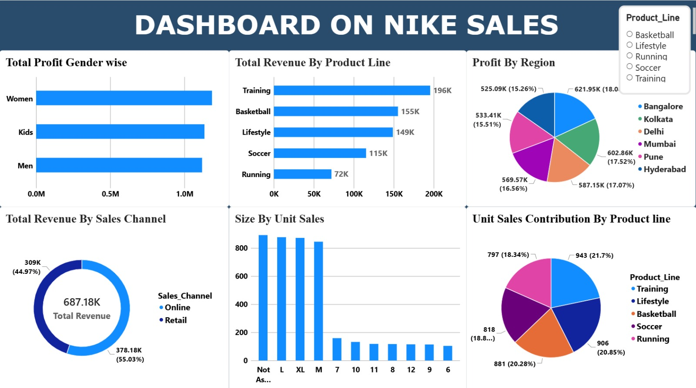
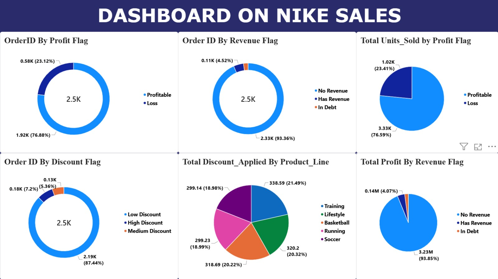

# 📊 Nike Sales Dashboard | Power BI

A two-page Power BI dashboard on Nike sales data, built as a learning project to practise data cleaning, dashboard design and insight writing.

---

## 🎯 Project Objective

Turn raw Nike sales data into a clear dashboard that answers questions such as:

- Which product lines earn the most revenue and sell the most units?
- How do profit and revenue differ by gender category, region and sales channel?
- How many orders are profitable and how many make a loss?
- How are discounts distributed across orders and product lines?

---

## 🖼️ Dashboard Preview

### Page 1 – Sales Performance


### Page 2 – Order Flags & Discounts


---

## 🗂️ Dataset

**File:** `data/Nike_Sales_Cleaned.xlsx` (100 order records, 16 columns)

| Column | Description |
|---|---|
| Order_ID | Unique order number |
| Gender_Category | Men / Women / Kids |
| Product_Line | Training, Basketball, Lifestyle, Soccer, Running |
| Product_Name | Name of the product (20 products) |
| Size | Apparel size (M, L, XL) or shoe size (6–12) |
| Units_Sold | Units in the order |
| MRP | Maximum retail price |
| Discount_Applied | Discount applied to the order |
| Revenue | Revenue from the order |
| Order_Date | Date of the order |
| Sales_Channel | Online / Retail |
| Region | Bangalore, Delhi, Hyderabad, Kolkata, Mumbai, Pune |
| Profit | Profit from the order |
| Profit Flag | Profitable / Loss |
| Discount Flag | Low / Medium / High Discount |
| Revenue Flag | No Revenue / Has Revenue / In Debt |

> **Note:** The dashboard shows about 2.5K orders, so it was built on a larger dataset than the sample file included here.

---

## 🛠️ Tools Used

- **Microsoft Excel** – data cleaning and preparation
- **Power BI** – data modelling, visuals and dashboard design
- **Microsoft Word** – insight report

---

## 🔍 Key Insights

- **Training** is the top product line by revenue (196K), while **Running** is the lowest (72K).
- **Online** brings in 55% of total revenue (378K of 687K).
- About **77% of orders are profitable** and about 23% make a loss.
- Profit is **evenly spread across regions**, between 15% and 18% each, with Bangalore leading.
- **Unit sales** are balanced across product lines (Training 21.7%, Running 18.3%).
- Almost **88% of orders** carry a low discount.
- Most profit sits in orders flagged "No Revenue", which suggests the revenue field is incomplete.

Full write-up: [`report/Nike_Sales_Insights_Report.docx`](report/Nike_Sales_Insights_Report.docx)

---

## 🧹 Data Quality Notes

- 27 orders have no order date.
- 18 orders have the size "Not Assigned".
- 12 rows have negative units (likely returns).
- 4 Order IDs are duplicated.
- 92% of orders have zero revenue.

---

## 📁 Repository Structure

```
nike-sales-dashboard-powerbi/
├── data/
│   └── Nike_Sales_Cleaned.xlsx
├── images/
│   ├── Dashboard-1.jpeg
│   └── Dashboard-2.jpeg
├── report/
│   └── Nike_Sales_Insights_Report.docx
├── Nike_Sales_Dashboard.pbix
└── README.md
```

---

## 🚀 How to Use

1. Download or clone this repository.
2. Open `Nike_Sales_Dashboard.pbix` in **Power BI Desktop**.
3. If prompted, update the data source to point to `data/Nike_Sales_Cleaned.xlsx`.
4. Use the **Product_Line** slicer on Page 1 to filter the visuals.

---

## 📚 What I Learned

- Choosing the right chart for each question
- Cleaning messy data (missing values, duplicates, inconsistent sizes)
- Creating flag columns to segment orders
- Writing clear, business-friendly insights

---

## 📬 Connect With Me

- LinkedIn: [https://www.linkedin.com/in/subhashree-subhalaxmi-sahoo/]

⭐ If you found this project useful, feel free to star the repo!
